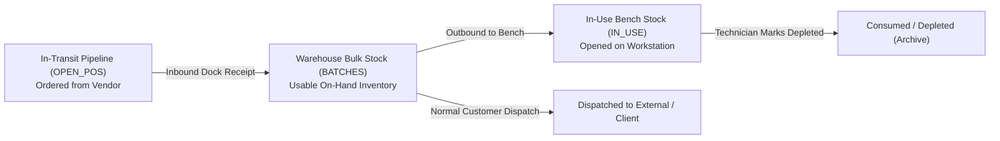

# OpenWMS v2.0 - System Architecture & Technical Design

## 1. Architectural Philosophy & Zero-Server Deployment
**OpenWMS v2.0** continues the serverless architecture pioneered in v1.0, expanding from basic warehousing into an integrated **Warehouse Management, Lab Bench, and Accounts Payable (AP)** platform.

```text
┌────────────────────────────────────────────────────────────────┐
│                       CLIENT TIER                              │
│  Single-Page Application (src/Index.html)                     │
│  - Tailwind CSS 3.x (Responsive UI & Dark Navigation)          │
│  - Chart.js (Inventory Consumption Trends & Time-series Drill) │
│  - SheetJS (Excel / CSV Reporting & Bulk Import Ingestion)     │
│  - In-App Interactive SOP Documentation Tab                    │
└───────────────────────────────┬────────────────────────────────┘
                                │ google.script.run (RPC Bridge)
┌───────────────────────────────▼────────────────────────────────┐
│                     APPLICATION TIER                           │
│  Google Apps Script V8 Runtime (src/Code.js)                  │
│  - Concurrency Gatekeeper (LockService, 15s Timeout)           │
│  - 3-Tier Inventory Engine (Bulk, Bench In-Use, Pipeline)      │
│  - FEFO Picking & 7-State Reorder Disambiguation Tree          │
│  - Accounts Payable FIFO Allocation & Anti-Overpayment Guard   │
│  - Dynamic Header Mapping & Text Format Protection             │
│  - Immutable Audit Ledger & Reversal Generator                │
└───────────────────────────────┬────────────────────────────────┘
                                │ Sheets API v4 (SpreadsheetApp)
┌───────────────────────────────▼────────────────────────────────┐
│                       STORAGE TIER                             │
│  Google Spreadsheet (Single Source of Truth - SSOT)            │
│  - ITEMS        (Master SKU Catalog & Storage Locations)       │
│  - BATCHES      (Lot Balances, Storage Bins & Expiry Dates)    │
│  - OPEN_POS     (Multi-line POs & Landed Obligations)          │
│  - PAYMENTS     (Accounts Payable & Vendor Invoices)           │
│  - IN_USE       (Lab Bench / Shop Floor Active Containers)     │
│  - TRANSACTIONS (Append-Only Historical Ledger)                │
└────────────────────────────────────────────────────────────────┘
```

---

## 2. Three-Tier Stock Classification

OpenWMS v2.0 formalizes three operational states for every SKU $i$:



1. **Warehouse Usable Stock ($I_{WH, i}^{\text{usable}}$)**:
   $$I_{WH, i}^{\text{usable}} = \sum_{b \in B_i, D_b > 0} \text{CurrentStock}_b$$
   *Crucial Rule*: Expired inventory is segregated ($D \le 0$) and excluded from safety stock calculations to prevent phantom inventory from concealing stockouts.
2. **In-Use Bench Stock ($I_{\text{bench}, i}$)**:
   $$I_{\text{bench}, i} = \sum_{u \in U_i^{\text{Active}}} \text{Qty}_u \quad (\text{Status} = \text{'IN\_USE'})$$
   *Crucial Rule*: Items moved to the bench are considered physically consumed from bulk storage ($\text{QtyOut}$ incremented in `BATCHES`). They do not satisfy warehouse $\text{MinStock}$ safety thresholds.
3. **In-Transit Pipeline ($I_{IT, i}$)**:
   $$I_{IT, i} = \sum_{p \in P_i^{\text{Active}}, \text{LineType} = \text{'ITEM'}} (\text{QtyOrdered}_p - \text{QtyReceived}_p)$$
   *Crucial Rule*: Fee lines (`LineType` = `'FEE'`) contribute 0 units to physical pipeline stock.

---

## 3. Accounts Payable (AP) & Landed Obligations Architecture

### 3.1. Landed Obligations vs. Inventory Capitalization
OpenWMS v2.0 implements **Landed Obligations Tracking** to reconcile complete vendor billing (merchandise plus delivery, handling, and ancillary freight):
$$\text{TotalObligation}_k = \sum_{j} \text{GoodsAmount}_{k, j} + \text{DeliveryFee}_k + \text{HandlingFee}_k + \text{OtherFees}_k$$
- **Design Boundary**: Fees are recorded as financial lines (`FEE_LOGISTICS`) in `OPEN_POS` and tracked in `PAYMENTS` to ensure 100% financial matching against vendor invoices. OpenWMS does **not** perform unit cost capitalization into physical inventory batches, maintaining zero-complexity serverless speed.

### 3.2. FIFO Sequential Payment Allocation & Overpayment Guard
When a payment $A_{\text{paid}}$ is recorded:
1. **Strict Balance Verification**:
   $$A_{\text{paid}} \le \sum_{r \in \text{Lines}_k} (\text{TotalAmount}_r - \text{PaidAmount}_r) + 0.0001$$
   Payments exceeding outstanding debt are aborted with an explicit error. Payments on cancelled POs are rejected.
2. **Sequential FIFO Disbursement**:
   Payment amounts are allocated across merchandise lines first, and logistics fee lines last:
   $$a_r = \min(\text{RemainingToAllocate}, \text{TotalAmount}_r - \text{PaidAmount}_r)$$
3. **Reversal / Voiding**:
   Voiding a payment decrements `PaidAmount` in reverse order (LIFO) and restores PO payment status.

---

## 4. Concurrency & Performance Engineering

### 4.1. Atomic Locking Pattern
To prevent race conditions during concurrent user operations (dock receipts, bench picking, invoice payments), all mutating functions follow strict LockService atomicity:

```javascript
function executeMutatingOperation(...) {
  const lock = LockService.getScriptLock();
  lock.waitLock(15000);

  try {
    // 1. Read SSOT directly from Google Sheets
    // 2. Validate domain constraints & stock availability
    // 3. Apply atomic sheet mutations
    SpreadsheetApp.flush(); // Force immediate disk persistence
    return { success: true, appData: getInitialAppData(ss) };
  } catch (err) {
    return { success: false, error: err.message };
  } finally {
    lock.releaseLock(); // Guaranteed unlock
  }
}
```

### 4.2. Dynamic Header Mapping
Sheets schemas are not hardcoded by numeric column indices:
```javascript
function buildRowByHeaders(headers, rowObj) {
  const cleanHeaders = headers.map(h => String(h).trim().toLowerCase().replace(/[\s_]/g, ''));
  // Dynamically maps rowObj properties to matching column indices
}
```
Columns can be reordered or extended in Google Sheets without breaking backend API calls.

### 4.3. High-Performance Batch Ingestion
Bulk inventory import (`bulkInitialInventory`) processes hundreds of records in RAM:
- Maps existing lots, validates SKU master references, and prepares update matrices.
- Commits updates in **1-2 API calls** (`setValues` and `appendRowsByHeaders`), completing 500+ SKU loads in under 2 seconds.
