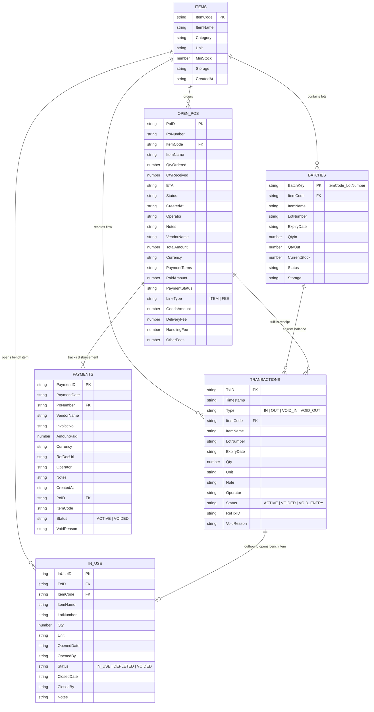

# OpenWMS v2.0 - Database Schema & Data Flow Specification

## 1. Overview
OpenWMS uses **Google Sheets** as its relational Single Source of Truth (SSOT). Version 2.0 maintains six normalized sheets within the active Google Spreadsheet:

1. **`ITEMS`**: Master SKU catalog, default storage bins, and reorder thresholds.
2. **`BATCHES`**: FEFO lot-level inventory ledger and physical storage locations.
3. **`OPEN_POS`**: In-transit purchase orders, multi-line items, and landed obligations.
4. **`PAYMENTS`**: Accounts Payable ledger recording vendor invoices and disbursements.
5. **`IN_USE`**: Lab bench / shop floor tracking of opened containers in active consumption.
6. **`TRANSACTIONS`**: Immutable historical audit ledger.

---

## 2. Relational Entity Relationship Diagram



---

## 3. Detailed Sheet Specifications

### 3.1. `ITEMS` (Master SKU Catalog)
| Col | Field Name | Type | Key | Nullable | Description |
| :--- | :--- | :--- | :--- | :--- | :--- |
| 1 | `ItemCode` | String | **PK** | No | Unique SKU (e.g. `SKU-001`). Auto-uppercase. |
| 2 | `ItemName` | String | - | No | Descriptive name. |
| 3 | `Category` | String | - | Yes | Category (e.g., `Reagent`, `Consumable`). |
| 4 | `Unit` | String | - | No | Unit of measure (`KG`, `PCS`, `BOX`, `VIAL`). |
| 5 | `MinStock` | Number | - | No | Reorder point threshold. If `0`, alert is bypassed. |
| 6 | `Storage` | String | - | Yes | Default storage location (`Cold Room B`, `Shelf 1`). |
| 7 | `CreatedAt` | ISO String | - | No | Registration timestamp. |

---

### 3.2. `BATCHES` (Lot-Level Inventory Balance)
| Col | Field Name | Type | Key | Nullable | Description |
| :--- | :--- | :--- | :--- | :--- | :--- |
| 1 | `BatchKey` | String | **PK** | No | Composite key: `${ItemCode}_${LotNumber}`. |
| 2 | `ItemCode` | String | **FK** | No | References `ITEMS.ItemCode`. |
| 3 | `ItemName` | String | - | No | SKU name. |
| 4 | `LotNumber` | String | - | No | Manufacturer lot (`'` strict formatting for leading zeros). |
| 5 | `ExpiryDate` | String | - | Yes | Expiration date (`YYYY-MM-DD` or `N/A`). |
| 6 | `QtyIn` | Number | - | No | Cumulative received quantity. |
| 7 | `QtyOut` | Number | - | No | Cumulative dispatched quantity. |
| 8 | `CurrentStock`| Number | - | No | Balance: $\text{CurrentStock} = \text{QtyIn} - \text{QtyOut}$. |
| 9 | `Status` | String | - | No | `Active` when $\text{CurrentStock} > 0$. |
| 10 | `Storage` | String | - | Yes | Physical storage location. |

---

### 3.3. `OPEN_POS` (In-Transit POs & Landed Obligations)
| Col | Field Name | Type | Key | Nullable | Description |
| :--- | :--- | :--- | :--- | :--- | :--- |
| 1 | `PoID` | String | **PK** | No | Unique ID: `PO-YYYYMMDD-HHmmss-N`. |
| 2 | `PoNumber` | String | - | No | External PO number (e.g., `PO-2026-089`). |
| 3 | `ItemCode` | String | **FK** | No | References `ITEMS.ItemCode` or `FEE_LOGISTICS`. |
| 4 | `ItemName` | String | - | No | Item name or fee description. |
| 5 | `QtyOrdered` | Number | - | No | Quantity ordered from supplier. |
| 6 | `QtyReceived`| Number | - | No | Cumulative quantity received at dock. |
| 7 | `ETA` | String | - | Yes | Expected arrival date (`YYYY-MM-DD` or `TBD`). |
| 8 | `Status` | String | - | No | `OPEN`, `PARTIAL`, `RECEIVED`, or `CANCELLED`. |
| 9 | `CreatedAt` | String | - | No | Creation timestamp (`YYYY-MM-DD HH:mm:ss`). |
| 10 | `Operator` | String | - | No | User email who created the PO. |
| 11 | `Notes` | String | - | Yes | Order terms, carrier tracking, or cancel reasons. |
| 12 | `VendorName` | String | - | No | Supplier name. |
| 13 | `TotalAmount` | Number | - | No | Total value for this line item. |
| 14 | `Currency` | String | - | No | Currency code (`USD`, `VND`, `EUR`). |
| 15 | `PaymentTerms`| String | - | Yes | Payment terms (`Net 30`, `COD`, `Advance`). |
| 16 | `PaidAmount` | Number | - | No | Cumulative amount paid against this line. |
| 17 | `PaymentStatus`| String | - | No | `UNPAID`, `PARTIAL`, or `PAID`. |
| 18 | `LineType` | String | - | No | `ITEM` (physical good) or `FEE` (logistics obligation). |
| 19 | `GoodsAmount`| Number | - | No | Base merchandise value. |
| 20 | `DeliveryFee`| Number | - | No | Freight / delivery charges. |
| 21 | `HandlingFee`| Number | - | No | Handling fees. |
| 22 | `OtherFees` | Number | - | No | Customs, tax, or auxiliary fees. |

---

### 3.4. `PAYMENTS` (Accounts Payable Ledger)
| Col | Field Name | Type | Key | Nullable | Description |
| :--- | :--- | :--- | :--- | :--- | :--- |
| 1 | `PaymentID` | String | **PK** | No | Unique ID: `PAY-YYYYMMDD-HHmmss`. |
| 2 | `PaymentDate`| String | - | No | Payment date (`YYYY-MM-DD`). |
| 3 | `PoNumber` | String | **FK** | No | References `OPEN_POS.PoNumber`. |
| 4 | `VendorName` | String | - | No | Vendor receiving payment. |
| 5 | `InvoiceNo` | String | - | No | Vendor invoice number (`'` strict text formatting). |
| 6 | `AmountPaid` | Number | - | No | Amount paid ($> 0$). |
| 7 | `Currency` | String | - | No | Currency. |
| 8 | `RefDocUrl` | String | - | Yes | Link to invoice or receipt PDF in Google Drive. |
| 9 | `Operator` | String | - | No | User recording payment. |
| 10 | `Notes` | String | - | Yes | Payment reference or wire note. |
| 11 | `CreatedAt` | String | - | No | Creation timestamp. |
| 12 | `PoID` | String | **FK** | Yes | Linked PO ID. |
| 13 | `ItemCode` | String | - | Yes | SKU or `ALL_ITEMS_AND_FEES`. |
| 14 | `Status` | String | - | No | `ACTIVE` or `VOIDED`. |
| 15 | `VoidReason` | String | - | Yes | Audit explanation if payment is voided. |

---

### 3.5. `IN_USE` (Lab Bench / Shop Floor Inventory)
| Col | Field Name | Type | Key | Nullable | Description |
| :--- | :--- | :--- | :--- | :--- | :--- |
| 1 | `InUseID` | String | **PK** | No | Unique ID: `USE-YYYYMMDD-HHmmss`. |
| 2 | `TxID` | String | **FK** | No | References `TRANSACTIONS.TxID` that opened this item. |
| 3 | `ItemCode` | String | **FK** | No | References `ITEMS.ItemCode`. |
| 4 | `ItemName` | String | - | No | SKU name. |
| 5 | `LotNumber` | String | - | No | Lot number. |
| 6 | `Qty` | Number | - | No | Container quantity opened on bench. |
| 7 | `Unit` | String | - | No | Unit of measure. |
| 8 | `OpenedDate` | String | - | No | Date opened on bench (`YYYY-MM-DD`). |
| 9 | `OpenedBy` | String | - | No | User who opened container. |
| 10 | `Status` | String | - | No | `IN_USE`, `DEPLETED`, or `VOIDED`. |
| 11 | `ClosedDate` | String | - | Yes | Date depleted / closed. |
| 12 | `ClosedBy` | String | - | Yes | User who depleted container. |
| 13 | `Notes` | String | - | Yes | Workstation ID or assay run notes. |

---

### 3.6. `TRANSACTIONS` (Immutable Historical Ledger)
| Col | Field Name | Type | Key | Nullable | Description |
| :--- | :--- | :--- | :--- | :--- | :--- |
| 1 | `TxID` | String | **PK** | No | Unique ID: `TX-YYYYMMDD-HHmmss` or `VOID-TX-...`. |
| 2 | `Timestamp` | String | - | No | Formatted datetime (`YYYY-MM-DD HH:mm:ss`). |
| 3 | `Type` | String | - | No | `IN`, `OUT`, `VOID_IN`, or `VOID_OUT`. |
| 4 | `ItemCode` | String | **FK** | No | References `ITEMS.ItemCode`. |
| 5 | `ItemName` | String | - | No | SKU name. |
| 6 | `LotNumber` | String | - | No | Lot number. |
| 7 | `ExpiryDate` | String | - | Yes | Lot expiry date. |
| 8 | `Qty` | Number | - | No | Quantity ($> 0$). |
| 9 | `Unit` | String | - | No | Unit. |
| 10 | `Note` | String | - | Yes | Remarks or linked PO reference. |
| 11 | `Operator` | String | - | No | User email. |
| 12 | `Status` | String | - | No | `ACTIVE`, `VOIDED`, or `VOID_ENTRY`. |
| 13 | `RefTxID` | String | - | Yes | References target TxID on void, or linked PO number on receipt. |
| 14 | `VoidReason` | String | - | Yes | Mandatory explanation for void. |

---

## 4. Zero-Truncation & Dynamic Header Mapping

```javascript
// Columns where leading zeros must be strictly preserved
const TEXT_STRICT_COLS = [
  'lotnumber', 'itemcode', 'ponumber', 'invoiceno', 
  'txid', 'batchkey', 'inuseid', 'paymentid', 'reftxid', 'poid'
];
```
- **Text Strict Rule**: When saving records through `buildRowByHeaders`, any pure numeric string belonging to these columns is prefixed with `'` (e.g. `'000123'`) to prevent Google Sheets from coercing it into an integer.
- **Dynamic Header Mapping**: Field order in sheets is auto-detected dynamically via `cleanHeaders.indexOf(cleanKey)`. New columns can be added to Google Sheets without breaking backend write logic.
