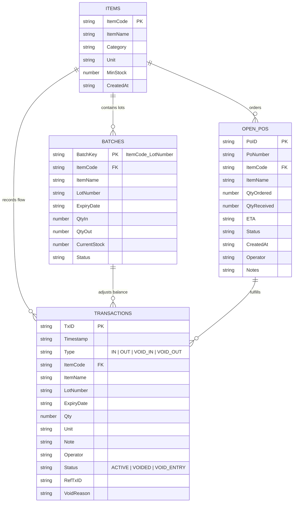
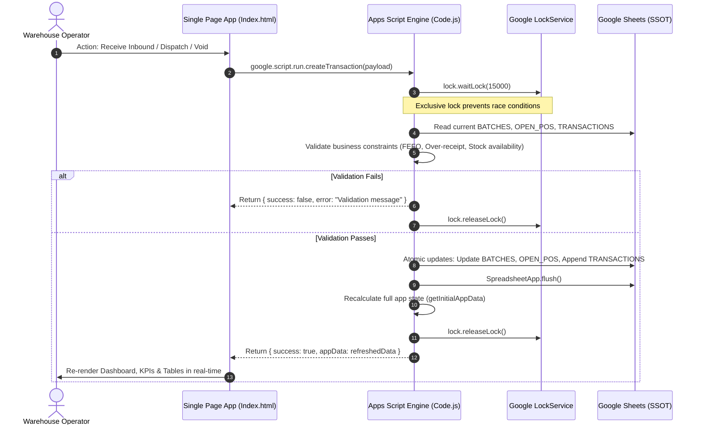

# OpenWMS - Database Schema & Data Flow Specification

## 1. Overview
OpenWMS uses **Google Sheets** as its relational Single Source of Truth (SSOT). All persistent data is stored in four normalized sheets within the active Google Spreadsheet:

1. **`ITEMS`**: Master SKU catalog and reorder thresholds.
2. **`BATCHES`**: FEFO lot-level inventory ledger.
3. **`OPEN_POS`**: In-transit purchase orders and delivery tracking.
4. **`TRANSACTIONS`**: Immutable historical audit ledger.

---

## 2. Relational Entity Relationship Diagram

---

## 3. Detailed Sheet Specifications

### 3.1. `ITEMS` (Master SKU Catalog)
Stores master definitions for each SKU tracked in the warehouse.

| Column Index | Field Name | Data Type | Key Type | Nullable | Description |
| :--- | :--- | :--- | :--- | :--- | :--- |
| 1 | `ItemCode` | String | **PK** | No | Unique SKU identifier (e.g., `SKU-001`). Auto-converted to uppercase. |
| 2 | `ItemName` | String | - | No | Descriptive commercial name of the item. |
| 3 | `Category` | String | - | Yes | Classification category (e.g., `Raw Material`, `Packaging`, `Finished Goods`). |
| 4 | `Unit` | String | - | No | Unit of measure (e.g., `KG`, `PCS`, `BOX`, `LITER`). |
| 5 | `MinStock` | Number | - | No | Reorder point threshold. If `0`, stockout alerting is bypassed. |
| 6 | `CreatedAt` | ISO String | - | No | Timestamp when the SKU was registered. |

---

### 3.2. `BATCHES` (Lot-Level Inventory Balance)
Tracks physical on-hand inventory segregated by lot number and expiry date.

| Column Index | Field Name | Data Type | Key Type | Nullable | Description |
| :--- | :--- | :--- | :--- | :--- | :--- |
| 1 | `BatchKey` | String | **PK** | No | Composite key: `${ItemCode}_${LotNumber}`. |
| 2 | `ItemCode` | String | **FK** | No | References `ITEMS.ItemCode`. |
| 3 | `ItemName` | String | - | No | Cached SKU name for fast read queries. |
| 4 | `LotNumber` | String | - | No | Manufacturer lot/batch tracking number (`N/A` for undated consumables). |
| 5 | `ExpiryDate` | String | - | Yes | Expiration date (`YYYY-MM-DD` or `N/A`). |
| 6 | `QtyIn` | Number | - | No | Cumulative units received into this lot. |
| 7 | `QtyOut` | Number | - | No | Cumulative units dispatched from this lot. |
| 8 | `CurrentStock`| Number | - | No | Calculated balance: $\text{CurrentStock} = \text{QtyIn} - \text{QtyOut}$. |
| 9 | `Status` | String | - | No | Status indicator (`Active` when $\text{CurrentStock} > 0$). |

---

### 3.3. `OPEN_POS` (In-Transit Purchase Orders)
Maintains supplier purchase orders and inbound pipeline quotas.

| Column Index | Field Name | Data Type | Key Type | Nullable | Description |
| :--- | :--- | :--- | :--- | :--- | :--- |
| 1 | `PoID` | String | **PK** | No | Unique system ID: `PO-YYYYMMDD-HHmmss`. |
| 2 | `PoNumber` | String | - | No | External supplier/ERP purchase order number (e.g., `PO-2026-008`). |
| 3 | `ItemCode` | String | **FK** | No | References `ITEMS.ItemCode`. |
| 4 | `ItemName` | String | - | No | Item name. |
| 5 | `QtyOrdered` | Number | - | No | Total quantity ordered from supplier ($> 0$). |
| 6 | `QtyReceived`| Number | - | No | Cumulative quantity received at the dock to date. |
| 7 | `ETA` | String | - | Yes | Estimated time of arrival (`YYYY-MM-DD` or `TBD`). |
| 8 | `Status` | String | - | No | `OPEN`, `PARTIAL`, `RECEIVED`, or `CANCELLED`. |
| 9 | `CreatedAt` | String | - | No | Order creation timestamp (`YYYY-MM-DD HH:mm:ss`). |
| 10 | `Operator` | String | - | No | Email of the purchasing officer who placed the order. |
| 11 | `Notes` | String | - | Yes | Supplier terms, freight tracking, or cancellation reasons. |

---

### 3.4. `TRANSACTIONS` (Immutable Audit Ledger)
Append-only ledger recording all stock movements and audit reversals.

| Column Index | Field Name | Data Type | Key Type | Nullable | Description |
| :--- | :--- | :--- | :--- | :--- | :--- |
| 1 | `TxID` | String | **PK** | No | Unique ID: `TX-YYYYMMDD-HHmmss` or `VOID-TX-...`. |
| 2 | `Timestamp` | String | - | No | Formatted transaction date and time (`YYYY-MM-DD HH:mm:ss`). |
| 3 | `Type` | String | - | No | `IN` (Inbound), `OUT` (Outbound), `VOID_IN`, or `VOID_OUT`. |
| 4 | `ItemCode` | String | **FK** | No | References `ITEMS.ItemCode`. |
| 5 | `ItemName` | String | - | No | Item name. |
| 6 | `LotNumber` | String | - | No | Associated lot number. |
| 7 | `ExpiryDate` | String | - | Yes | Lot expiry date. |
| 8 | `Qty` | Number | - | No | Transaction quantity ($> 0$). |
| 9 | `Unit` | String | - | No | Unit of measure. |
| 10 | `Note` | String | - | Yes | Remarks, delivery notes, or linked PO references. |
| 11 | `Operator` | String | - | No | Email of the authenticated user performing the action. |
| 12 | `Status` | String | - | No | `ACTIVE` (normal), `VOIDED` (reversed), `VOID_ENTRY` (reversal row). |
| 13 | `RefTxID` | String | - | Yes | References target TxID on void, or linked PO number on receipt. |
| 14 | `VoidReason` | String | - | Yes | Mandatory audit justification for reversed transactions. |

---

## 4. End-to-End Data Flow

